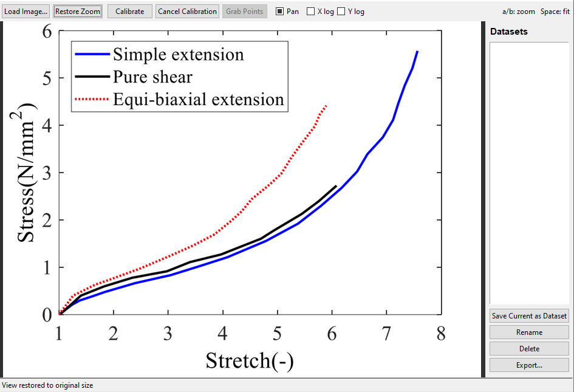

# Calibration Raw Code

This script provides a command-line utility for parameter identification without a graphical user interface (GUI).

## Installation Requirements

To install the required dependencies, run the following command in your terminal:

```bash
pip install matplotlib numpy scipy
```

Optional dependency for enhanced plot styling:
```bash
pip install scienceplots
```

## Usage

1. Place your experimental data in a `.txt` file named `test_data.txt` in the same directory as `Calibration_raw.py`.
2. Run the script. The code jointly calibrates the selected constitutive models to the experimental data using nonlinear least-squares optimization based on the first Piola–Kirchhoff stress.

### Evaluation Metrics
The quality of the calibration is evaluated using the following metrics:
- Relative root-mean-square error
- Root-mean-square error (**RMSE**)
- Normalized root-mean-square error (**NRMSE**)
- Coefficient of determination ($R^2$)
- Maximum absolute error

### Outputs
- **Console Summary:** The fitted material constants and corresponding goodness-of-fit measures are reported for each model.
- **Visualizations:** Comparison plots of the calibrated model predictions against experimental data are generated and saved in `.svg` and `.tiff` formats.
- **Log File:** A formatted summary of the calibration results is saved to `fit_results.txt`.

> **Important:** Appropriate parameter bounds and initial guesses are critical for obtaining stable and physically meaningful solutions from nonlinear least-squares optimization.

---

# Data Calibration Utility (`Calibration_App.py`)

To provide a user-friendly environment, `Calibration_raw.py` has been extended into a graphical application (`Calibration_App.py`).

## Installation Requirements

To install the required dependencies, run the following command in your terminal:

```bash
pip install matplotlib numpy scipy tkinter importlib
```

Optional dependency for enhanced plot styling:
```bash
pip install scienceplots
```

## Usage

Run the application script (`Calibration_App.py`) to launch the graphical user interface.

### Input Requirements
The application requires a `.csv` file containing experimental data from uniaxial and pure shear tests. The data file must include the following column headers:
* `stretch_uniaxial`
* `stress_uniaxial`
* `stretch_pure_shear`
* `stress_pure_shear`

### Implemented Constitutive Models
The software includes the following hyperelastic material models:
* Neo-Hookean
* Mooney-Rivlin
* Yeoh
* Gent
* Anssari-Benam

| Model | Parameters |
|:---:|:---:|
| Neo-Hookean | $C_{10}$ |
| Mooney-Rivlin | $C_{10}, C_{01}$ |
| Gent | $\mu, J_m$ |
| Yeoh | $C_1, C_2, C_3$ |
| Anssari-Benam | $\mu, N, n, \beta, C_{20}, \varepsilon$ |

### Output and Visualization
1. **Visualization:** Calibration curves, goodness-of-fit metrics (e.g., $R^2$, RMSE), and optimized material parameters are rendered in dedicated UI panels for immediate review.
2. **Exported Files:** 
   - Vector graphics of the calibration plots (`.svg`).
   - A summary report containing fitting metrics and optimized material parameters (`.txt`), saved automatically to the working directory.

---

# Image Graph Digitizer (`Digitizer.py.py`)

**Image Graph Digitizer** is a lightweight, Python-based GUI tool designed for extracting numerical data from image-based plots. It provides a simple calibration workflow and flexible data export options, making it an essential utility for researchers needing to digitize data from legacy plots, literature figures, or experimental images.

<figure style="text-align: center; margin: 20px 0;">
  
  <figcaption style="margin-top: 8px; font-size: 0.9em; color: #555;">
    <em>User interface of the Image Graph Digitizer (<code>grabit.py</code>).</em>
  </figcaption>
</figure>


## Features
* **Intuitive Calibration:** Supports both linear and logarithmic axes (X and Y).
* **Navigation:** Zoom and pan capabilities for precise point selection.
* **Dataset Management:** Create, rename, and organize multiple datasets within a single session.
* **Flexible Exports:** Save data in various formats including `.txt`, `.csv`, `.npz` (NumPy), and `.mat` (MATLAB).

## Requirements
* **Python 3.x**
* **Pillow** (Required for image processing): `pip install Pillow`
* **NumPy & SciPy** (Optional, for advanced export formats): `pip install numpy scipy`

## Quick Start
1. **Launch:** Run the script using `python grabit.py`.
2. **Load:** Click **"Load Image..."** to import your plot.
3. **Calibrate (Crucial):** 
   - Click **"Calibrate"**.
   - Follow the status bar prompts to click four reference points on the graph: **X-Origin**, **X-Max**, **Y-Origin**, and **Y-Max**.
   - Enter the corresponding real-world values when prompted.
4. **Grab:** Click **"Grab Points"** and begin clicking on your data series.
5. **Finish:** Press **Enter** when done to finalize the dataset, then save/export it using the sidebar.

## Keyboard Shortcuts
* **`a` / `b`**: Zoom In / Zoom Out
* **`Space`**: Fit image to window
* **`r`**: Restore zoom level
* **`Backspace` / `Delete`**: Remove the last grabbed point (during "Grabbing" mode)
* **`Enter`**: Complete point acquisition
* **Mouse Middle-Click (Drag)**: Pan the image
```